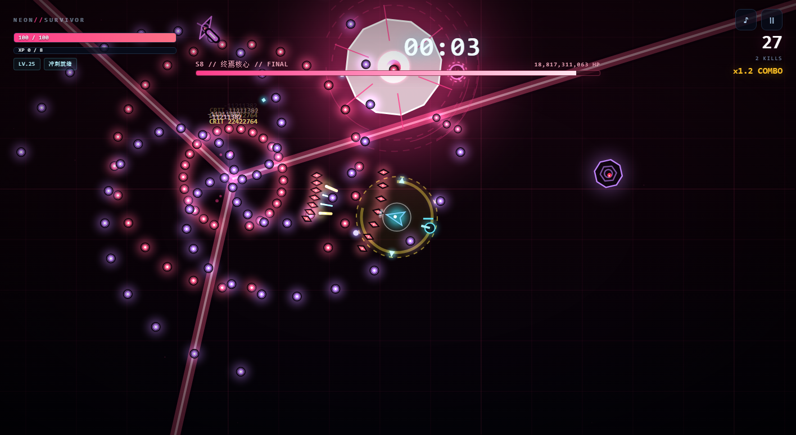

# 霓虹幸存者 · NEON SURVIVOR 2.0

一款纯 HTML5 Canvas 的俯视角 Roguelite 生存射击游戏。  
**无需安装、无需联网、无外部依赖，双击 `index.html` 即玩。**



---

## 运行

- 直接双击 `index.html`，或拖进 Chrome / Edge / Firefox。
- 首次点击「开始生存」后启用程序合成音效（浏览器要求用户手势）。
- 手机/平板：自动切换为左侧虚拟摇杆 + 右侧冲刺按钮。
- 手机竖屏进入时显示「请横屏游玩」；点击按钮会尝试全屏并锁定横屏，不支持方向锁定的浏览器可手动旋转。
- 手机端视野按 **68%** 缩放，显示更多战场；Boss 半径再按桌面端的 **50%** 缩放。
- 移动端 HUD、Boss 血条、横幅和虚拟按键按 **78%** 缩放，避免 UI 占满画面。
- 移动端升级界面保持桌面端 **三列卡片**结构，卡片和间距压缩；名称约 12～14px、描述约 10～11px，兼顾紧凑和可读性。
- 微信内置浏览器无法锁定横屏时，会提供「仍然竖屏游玩」入口，也可以从右上角菜单转到外部浏览器。
- 每次打开游戏会先显示「荒原生存指南」，列出按键与目标；按 `Enter` 或点按钮进入标题。
- 最高分、最长生存时间保存在浏览器本地。

## 操作

| 操作 | 键鼠 | 触屏 |
| --- | --- | --- |
| 移动 | `WASD` / 方向键 | 左侧摇杆 |
| 冲刺（短暂无敌） | `SPACE` | 右侧「冲刺」按钮 |
| 暂停 | `ESC` | 右上角暂停按钮 |
| 静音 | `M` | 右上角音符按钮 |
| 选择升级 | `1` / `2` / `3` 或点击卡片 | 点击卡片 |
| 刷新升级 | `R` | 点击「刷新」 |
| 重开 | 结算界面 `R` 或按钮 | 按钮 |

自动索敌、自动开火——你只需要专注走位、冲刺和构筑。

## Boss 挑战

标题界面新增「Boss 挑战」按钮：

- 打开 8 个关卡的 Boss 列表，可直接选择任意核心
- 自动配置对应等级的预设构筑（第 1 关 LV.8 → 第 8 关 LV.22）
- 立即进入单 Boss 战，不经过普通波次
- 挑战模式不结算经验、不触发升级暂停；击破 Boss 即挑战成功
- 终焉核心挑战卡会标注 **200 亿 HP**

## 八大区域

每个区域有不同的小怪清剿目标：**24 / 32 / 40 / 48 / 58 / 68 / 80 / 92**。必须把本关刷出的全部小怪清空，Boss 才会出现。Boss 死亡后进入下一区域，并回复生命；HUD 会实时显示 `击杀 / 目标`。

| 区域 | Boss | 核心机制 |
| --- | --- | --- |
| 1 碎裂回廊 | 裂隙守卫 | 环形弹幕、召唤小怪；二阶段加入旋转螺旋与裂隙召唤 |
| 2 蜂巢苗圃 | 蜂巢母体 | 双臂旋转螺旋、环形弹幕、持续召唤浮游炮 |
| 3 熔核铸造厂 | 熔核巨像 | 蓄力冲锋、留下火焰池、环形火弹与扇形弹 |
| 4 虚空织机 | 虚空织者 | 瞬移、十字激光预警、扇形弹与环弹 |
| 5 霜蚀棱镜 | 霜蚀棱镜 | 环绕移动、三向旋转激光、冰霜区域与碎片弹 |
| 6 雷暴天线 | 雷暴核心 | 全场落雷预警、环弹、召唤、激光 |
| 7 镜像剧场 | 镜像双子 | 双卫星瞄准、镜像克隆扇形、水平翻转、空间换位、反射激光 |
| 8 终焉之门 | 终焉核心 | 三阶段混合：环弹、螺旋、双旋转激光、火池/雷击、召唤 |

## 手机端

- 世界视野缩放 **68%**，HUD 与虚拟按键缩放 **78%**。
- 竖屏提示旋转，横屏后自动恢复游戏画面。
- 横屏按钮会尝试 `requestFullscreen()` + `screen.orientation.lock('landscape')`。
- 世界视野在粗指针设备上缩放到 **75%**，玩家、Boss、经验都会变小，能看到更远。
- Boss 半径再缩放到 **50%**；S5 棱镜小怪同比缩放。
- 微信内置浏览器提供「仍然竖屏游玩」入口，外部浏览器可尝试横屏锁定。

## Boss 专属技能

| Boss | 新增技能 |
| --- | --- |
| S1 裂隙守卫 | 第 2/3 阶段劈开裂缝，裂缝开启后涌出 10 只小怪，随后关闭 |
| S2 蜂巢母体 | 第 3 阶段召唤蜂巢，涌出 20 只蜂群；接触后施加 5 秒腐蚀，每秒扣 1 HP |
| S3 熔核巨像 | 全阶段地面冒出岩浆，站在上面每秒扣 2 HP；岩浆持续 3 秒，触发间隔随阶段缩短 |
| S4 虚空织者 | 虚空编织预警后拉入虚空，击败 25 只小怪才能离开；第一次 25 只，之后每次 +5；冷却 90 秒 |
| S5 霜蚀棱镜 | 召唤 50% 体型、20% Boss 血量的棱镜怪；它发射带 1.5 秒预警的激光；死亡 30 秒后再召唤 |
| S6 雷暴核心 | 矩形落雷预警 1 秒，矩形与闪电都会闪烁，命中造成伤害 |
| S7 镜像双子 | 保持现有镜像克隆、水平翻转、空间换位与反射激光 |
| S8 终焉核心 | 弹幕总量下调；全阶段每阶段 3 次 1/6 扇形轰击，命中扣 25 HP；扇形轰击时地面逐根弹出弹幕 |

补充机制：

- 所有 Boss 每 8～13 秒有 **20%** 概率回复 **4% 最大生命**，伴随绿色回复特效。
- 终焉核心每 6～10 秒有 **20%** 概率借用前 7 个 Boss 的一个技能，并在上方显示「回响 // …」。
- 熔核巨像的冲锋落点冲击波现在会造成范围伤害；冲锋预警激光和阶段激光都会持续到预警结束并正常造成伤害。
- 虚空织者拉入/离开虚空时有吸入、连续刷怪、跳出与 Boss 渐现动画。

## Boss 阶段

Boss 在 66% / 33% 血量进入第 2、3 阶段。阶段提示只显示「BOSS 第 X 阶段」；每个阶段会解锁新的攻击方式，而不是只改数值：

| Boss | 第 2 阶段新增 | 第 3 阶段新增 |
| --- | --- | --- |
| 裂隙守卫 | 四向旋转激光 | 缺口环 + 虚空落点 |
| 蜂巢母体 | 六臂螺旋 | 缺口环 + 浮游炮召唤 |
| 熔核巨像 | 三段落火 | 四向激光 + 大范围火池 |
| 虚空织者 | 三向传送激光 | 虚空区 + 旋转激光 |
| 霜蚀棱镜 | 霜冻区域 | 三向折射激光 |
| 雷暴核心 | 雷暴落点 | 雷暴网格 + 瞄准激光 |
| 镜像双子 | 水平翻转（左右移动反转） | 空间换位 + 对称反射激光 |
| 终焉核心 | 额外火池/雷击 | 缺口环收紧 |

## 弹幕辨识规则

- **你的攻击**：青/白色细长弹道、白色核心、金色追踪导弹。没有深色描边。
- **敌方弹幕**：深色描边 + 高饱和内芯，并按攻击类型区分形状：
  - 圆环弹：Boss 环形/螺旋
  - 菱形碎片：瞄准/狙击
  - 长条闪电：快速直线弹
  - 尖刺星：特殊弹幕
- **敌人本体**：深色剪影、发光轮廓、红色单眼；精英带橙色虚线环。
- **玩家本体**：白青色三角飞船，护盾为六边形气泡，僚机为小三角。

## 敌人

- **裂爪**：基础突击单位，正面爪形轮廓。
- **游隼**：高速蛇形突进，黄色飞镖。
- **重装**：高血量六边形装甲，死亡分裂。
- **炮塔**：保持距离的三联炮台。
- **浮游炮**：环绕移动并发射三连弹。
- **自爆虫**：贴近后自爆，橙色尖刺。
- **狙击者**：蓄力后发射高速长条弹，带红色瞄准线。
- **精英**：高血量、环形弹幕、掉落数据核心。

## 索敌与血量反馈

主武器、棱镜射线、僚机和炮台现在按**距离**选择目标：最近的敌人优先，Boss 不再无条件抢锁。Boss 血条同时显示精确 HP，命中时会出现伤害数字与闪白。

## 平衡与性能调整

- **玩家基础脉冲**：22 伤害 / 0.32 秒；每次升级额外获得 **+2.5% 全伤害**，过载弹芯与副武器同步加强。
- **Boss 血量**：前七关为 6,000 / 10,000 / 15,000 / 21,000 / 28,000 / 37,000 / 48,000；**终焉核心为 200 亿（20,000,000,000）**。
- **精英怪**基础血量提升到 3,000，刷新间隔缩短到约 20 秒；精英不再是一碰就碎。
- **小怪**基础血量整体提高，刷新数量和频率提高，场上普通敌人硬上限 **100**；分裂和 Boss 召唤也受上限约束。
- **Boss 经验**按当前升级需求与关卡共同缩放，越后面的 Boss 给得越多；Boss 经验核心会快速飞向玩家。
- **渲染开销**：设备像素比上限 1.5；粒子上限 360、经验核心上限 200、战斗文字上限 50；大群敌人时关闭普通小怪光晕，保留轮廓与红眼。
- **自动性能模式**：持续低帧率时自动限制场上敌人数量、减少粒子和弹幕光晕，避免百人混战时卡死。
- **异常保护**：主循环异常会先尝试自动继续，连续异常才暂停并显示「运行异常」；超过 2.5 秒无帧响应会自动重启渲染循环，避免画面静止。
- **Boss 血条**显示精确 HP；索敌按距离选择最近敌人。

## 终焉核心

- 独立 **200 亿**装甲，三阶段战斗。
- 弹幕层：带缺口的环形弹、4～6 臂旋转螺旋、瞄准扇形、3～5 道旋转激光、落雷/火池与召唤物。
- 每一层都留有可穿越的缺口；冲刺无敌帧可以穿弹，闪现前会显示目标圈。
- 终焉核心的伤害按亿级结算，Boss 血条显示精确的 20,000,000,000 HP。
- 腐蚀/持续伤害只应用一次伤害倍率，不会因高倍率瞬间秒杀终焉核心。

## 升级模块

共 **33 个模块**，升级时随机三选一，每级可刷新一次：

- **脉冲**：过载弹芯、超频回路、分裂枪管、穿甲弹头、临界瞄准、加速弹道、跳弹弹头、霜冻弹头、腐蚀弹头、处决协议、暴击奇点
- **武器**：轨道刃、追猎导弹、链式电弧、脉冲新星、棱镜射线、僚机编队、部署炮台、连锁殉爆
- **生存**：扩容装甲、相位镀层、磁力线圈、吸血协议、背水一战、反伤力场、护盾电容
- **机动/成长**：矢量推进、冷却超频、冲刺过载、数据嗅觉、赏金协议、超载核心、熵减场

新系统包括：自动充能护盾、环绕僚机、固定炮台、贯穿射线、跳弹、冻结、腐蚀、暴击爆炸、击杀连锁爆炸。

## 文件

```
game/
├─ index.html   页面、HUD 与界面
├─ style.css    霓虹 UI、响应式布局、移动端摇杆
├─ game.js      关卡、Boss AI、敌人、升级、弹幕、绘制、音效
├─ preview.png  游戏预览图
└─ README.md    本说明
```

## 验证

- `node --check game/game.js` 通过。
- 无头 Edge 完整跑通：开始 → 普通波次 → 自动 Boss 触发 → 8 个 Boss 的独立弹幕 → 区域切换 → 终焉核心胜利。
- 所有 8 个 Boss 均产生专属弹幕/危险区；浏览器控制台无异常。
- 390×844 手机视口下摇杆、冲刺按钮、Boss HUD 均无横向溢出。

---

祝你穿越八区，终结荒原。
